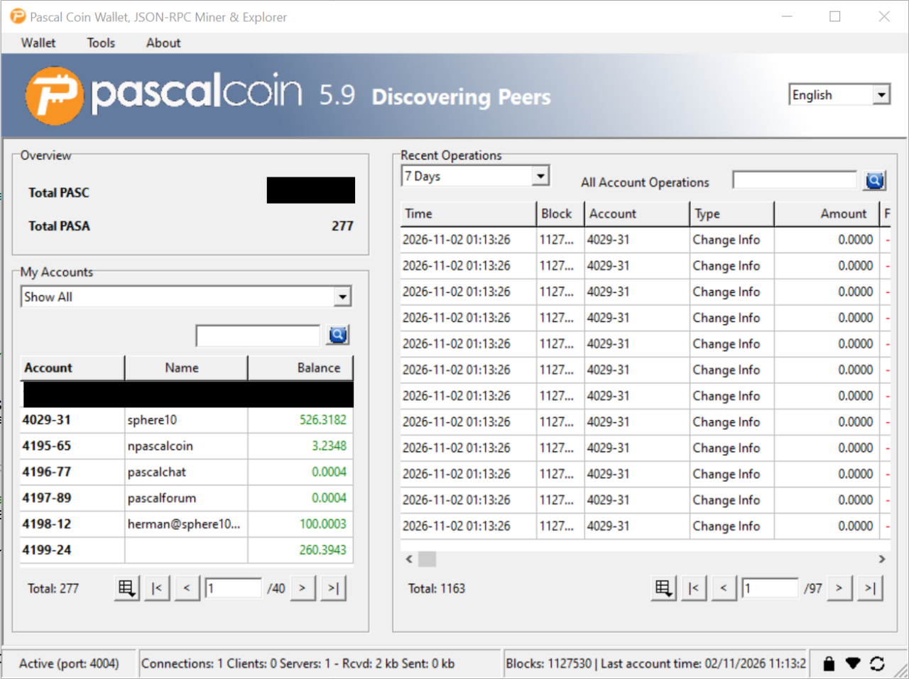
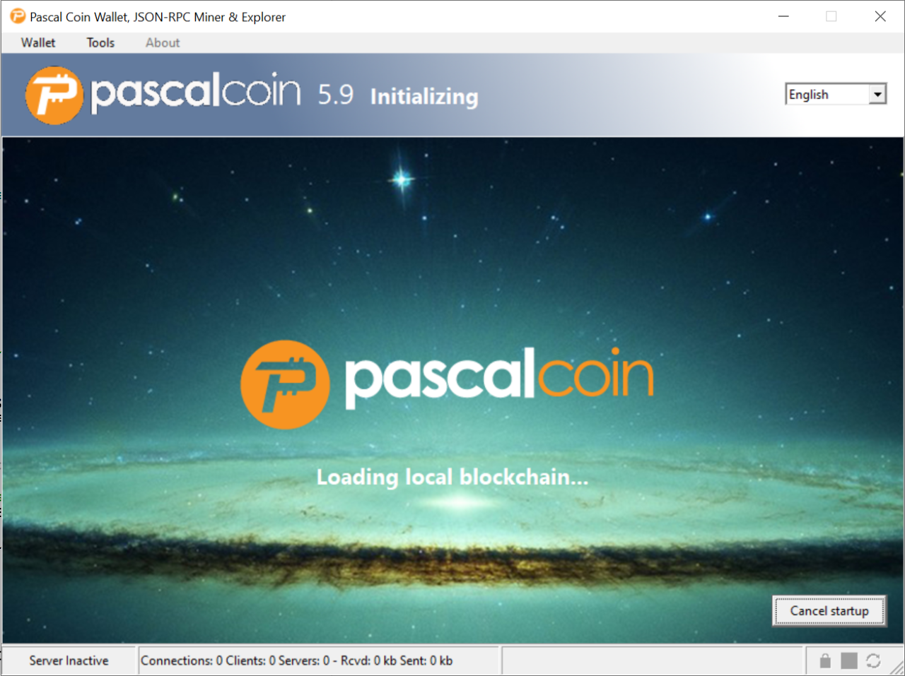
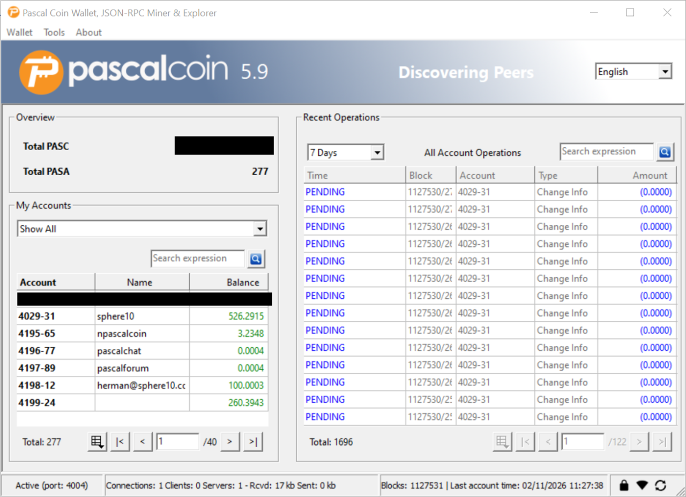
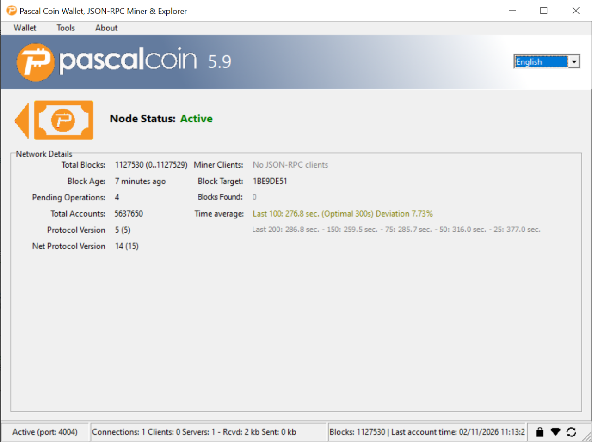
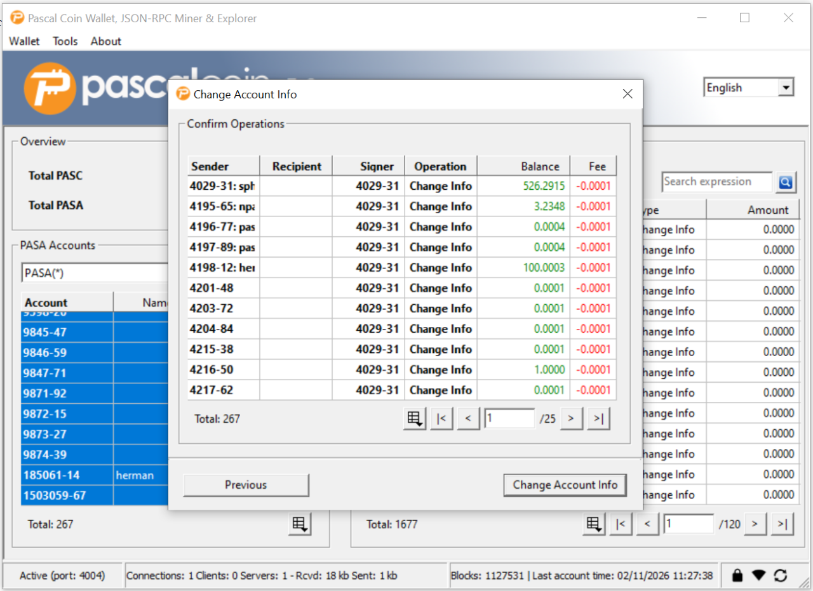
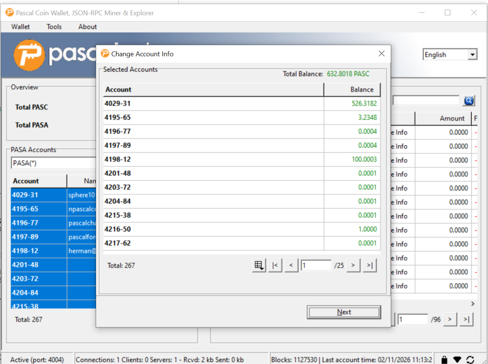
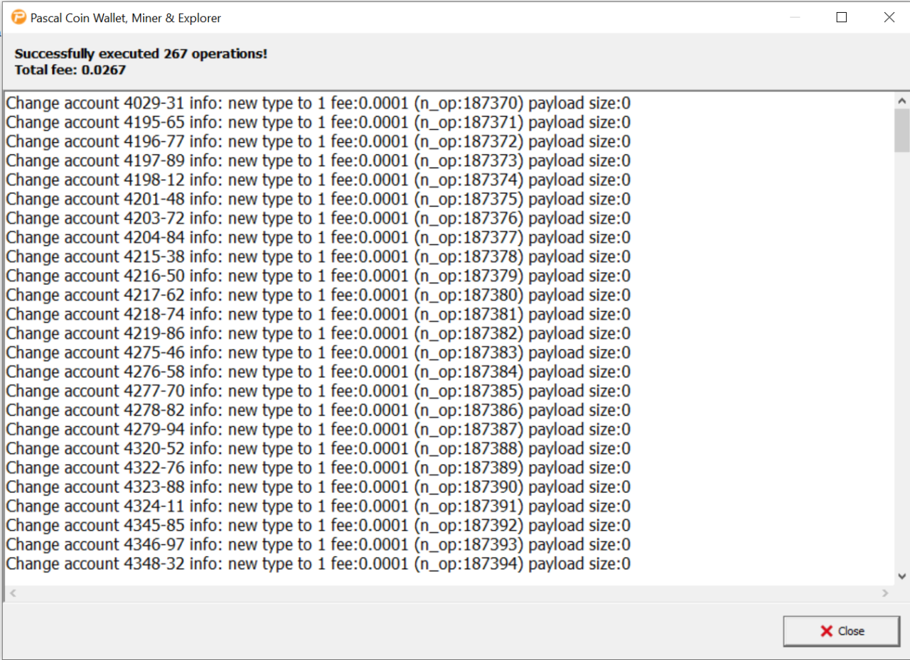
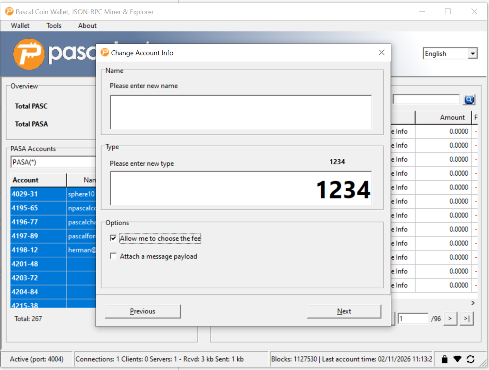
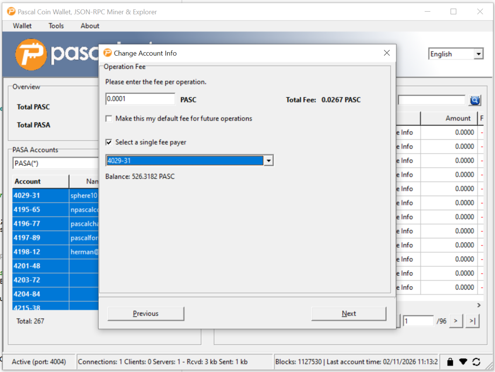

[](https://github.com/PascalCoin/PascalCoin/actions)
[](https://github.com/PascalCoin/PascalCoin/releases)
[](LICENSE)
[](https://discord.gg/9YYZyw)
[](https://www.reddit.com/r/pascalcoin)

<p align="center"></p>

Copyright © 2016–2026 PascalCoin developers, based on original Albert Molina source code.

Please use at your own risk.

# PascalCoin - A One of a Kind Cryptocurrency

**PascalCoin is an instant, zero-fee, infinitely scalable, decentralized cryptocurrency with advanced privacy and smart contract capabilities. It is the world's first blockchain independent of historical operations.**

**PascalCoin possesses unlimited potential.**

PascalCoin is a peer-to-peer cryptocurrency written in Object Pascal. **PASC**
is its currency, and a **PASA** is a numbered account. This repository contains
two desktop wallets, a node daemon and a reference miner. PascalCoin's original
implementation is by **Albert Molina**, with significant contributions by
**Herman Schoenfeld** (such as the Experimental Wallet and core changes),
alongside the work of the PascalCoin contributors.



## Downloads

[PascalCoin 5.9.5](https://github.com/PascalCoin/PascalCoin/releases/tag/5.9.5)
archives contain all four applications. Drag the wallet apps from the macOS disk
image to Applications. They run natively on Apple silicon and Intel Macs.

| Platform | Package |
|---|---|
| Windows x64 | [PascalCoin-5.9.5-x86_64-win64.zip](https://github.com/PascalCoin/PascalCoin/releases/download/5.9.5/PascalCoin-5.9.5-x86_64-win64.zip) |
| Linux x64 | [PascalCoin-5.9.5-x86_64-linux.tar.gz](https://github.com/PascalCoin/PascalCoin/releases/download/5.9.5/PascalCoin-5.9.5-x86_64-linux.tar.gz) |
| macOS, wallet apps | [PascalCoin-5.9.5-macOS.dmg](https://github.com/PascalCoin/PascalCoin/releases/download/5.9.5/PascalCoin-5.9.5-macOS.dmg) |
| macOS, all programs | [PascalCoin-5.9.5-x86_64-darwin.tar.gz](https://github.com/PascalCoin/PascalCoin/releases/download/5.9.5/PascalCoin-5.9.5-x86_64-darwin.tar.gz) |

Verify packages against the release's
[SHA256SUMS](https://github.com/PascalCoin/PascalCoin/releases/download/5.9.5/SHA256SUMS).
See [Build 5.9.5](CHANGELOG.md#build-595) for the patch changes.
[All releases](https://github.com/PascalCoin/PascalCoin/releases) include earlier
mainnet and testnet builds.

The macOS apps are not notarized. On first start, click **Open Anyway** for each
app in **System Settings > Privacy & Security**. On macOS 14 and earlier,
Control-click the app and choose Open.

| Application | Executable in the package | Purpose |
|---|---|---|
| Classic wallet | `PascalCoinWalletLazarus` | Wallet, miner and explorer interface |
| Experimental wallet | `PascalCoinWalletExperimental` | Operation wizards and paged account and history views |
| Daemon | `pascalcoin_daemon` | Node and JSON-RPC service without a desktop interface |
| Reference miner | `PascalCoinMiner` | Standalone mining application |

Keep `locale`, miner resources, runtime libraries and license notices beside the
extracted executables. Launch Linux GUI builds from the extracted folder. They
need GTK2.

## Wallet features

The experimental wallet provides:

| Area | Features |
|---|---|
| Accounts | Filter, select and inspect your accounts, which a new key does not create (see **Get An Account**). |
| History | View pending operations, decoded payloads and account or wallet history for **7 Days**, **30 Days** or **Maximum**. |
| Keys | Manage private and watch-only keys and wallet backups, and unlock the wallet to sign or add private keys. |
| Payments | Send PASC with custom fees and an optional public, key-encrypted or password-encrypted payload. |
| Account management | Buy, list for public or private sale, delist, and change owner keys, names and types. |
| Advanced operations | The classic advanced form handles account data, EPASA addressing, swaps, hash locks and recipient-signed purchases. |
| RAW workbench | Import and export RAW packages, combine multioperations, sign locally or offline, merge returned signatures and execute. |
| Explorers | Browse accounts, pending operations, operations by block or hash, and block timing and hash-rate statistics. |
| Network and tools | Manage peers, ports, allowed IPs and checkpoint downloads, and use the RPC client, peer messages and logs. |
| Mining | Configure mining and the reward key, which must be an eligible private key. |
| Languages | Choose English or partly translated Dutch in the banner or Options, then restart. |

The [feature map](src/gui-experimental/FEATURES.md) lists the classic
equivalents, and the [wallet guide](src/gui-experimental/README.md) and
[Build 5.9 changes](CHANGELOG.md#build-59---2026-10-28) give details.

## Screenshots

<details>
<summary>Startup, node status and a batch account-type change</summary>

| Startup and account setup | Wallet and operation review |
|---|---|
| [](docs/screenshots/5.9/experimental-delphi-startup.webp)<br>Delphi: cancelable local blockchain loading. | [](docs/screenshots/5.9/experimental-fpc-wallet.webp)<br>FPC: wallet accounts and pending operations. |
| [](docs/screenshots/5.9/experimental-delphi-node-status.webp)<br>Delphi: node status, chain statistics and mining information. | [](docs/screenshots/5.9/experimental-fpc-batch-confirmation.webp)<br>FPC: review account changes, signer and fees before execution. |
| [](docs/screenshots/5.9/experimental-delphi-batch-selection.webp)<br>Delphi: review 267 selected accounts in the account-information wizard. | [](docs/screenshots/5.9/experimental-fpc-batch-result.webp)<br>FPC: scrollable results for 267 account-information operations. |
| [](docs/screenshots/5.9/experimental-delphi-account-info.webp)<br>Delphi: account name, type, fee and payload options. | [](docs/screenshots/5.9/experimental-delphi-batch-fees.webp)<br>Delphi: custom per-operation fee, total fee and a single fee payer. |

</details>

[Screenshot provenance and checksums](docs/screenshots/README.md).

## Build

The source includes its Pascal libraries. The experimental wallet's
[build guide](src/gui-experimental/README.md#build) covers compiler options and
runtime layout.

### Lazarus/FPC

With `lazbuild` and FPC, build all four applications into `src`, named as in the
application table, on Windows, Linux or macOS. Run from the repository
root:

```sh
lazbuild -B src/pascalcoin_daemon.lpi
lazbuild -B src/pascalcoin_miner.lpi
lazbuild -B src/pascalcoin_wallet_classic.lpi
lazbuild -B src/pascalcoin_wallet_experimental.lpi
```

For the experimental wallet, add `--build-mode=Release` for an optimized build or
`--build-mode=Debug` for debugging. `Default` is unoptimized.

- On macOS, add `--ws=cocoa` to both wallet commands. Linux uses GTK2.
- On Windows and Linux, copy OpenSSL 1.1 from `windows-dll` or `linux-libs`
  beside the programs.
- Keep `src/locale` and `src/pascalsha.cl` with distributed programs.
- On macOS, `bash build/macOS/package-macos.sh src dist` packages both wallets in
  a disk image. See [build/README.md](build/README.md).

### Delphi

On Windows, open
[pascalcoin_wallet_classic.dproj](src/pascalcoin_wallet_classic.dproj) or
[pascalcoin_wallet_experimental.dproj](src/pascalcoin_wallet_experimental.dproj)
in the Delphi IDE. The builds write `src/pascalcoin_wallet_classic.exe` and
`src/pascalcoin_wallet_experimental.exe`. Only classic Win64 Release and
experimental Win64 Debug builds from Delphi 13 Community Edition are verified.

In editions with command-line compilers, run from the repository root in the
**RAD Studio Command Prompt**:

```bat
msbuild src\pascalcoin_wallet_classic.dproj /t:Build /p:Config=Release /p:Platform=Win64
msbuild src\pascalcoin_wallet_experimental.dproj /t:Build /p:Config=Release /p:Platform=Win64
```

In Community Edition, select the configuration and platform in the IDE, then run
AutoBuild:

```bat
bds.exe -b src\pascalcoin_wallet_classic.dproj
bds.exe -b src\pascalcoin_wallet_experimental.dproj
```

See Embarcadero's [MSBuild guide](https://docwiki.embarcadero.com/RADStudio/Sydney/en/MSBuild)
and [IDE command options](https://docwiki.embarcadero.com/RADStudio/Alexandria/en/IDE_Command_Line_Switches_and_Options).

## Test

On Windows with Lazarus/FPC, build the experimental wallet, then run from the
repository root:

```powershell
& .\src\tests\experimental\RunAllWalletTests.ps1
```

Add `-FpcPath`, `-LazarusDirectory`, `-WalletExecutable` and a new
`-OutputDirectory` as needed. Tests run offline on private Windows desktops with
temporary keys and data. The [test guide](src/tests/experimental/README.md)
describes the coverage, the portable lock tests for Linux and macOS, Delphi
probes and optional large-chain fixtures.

For a separate experimental wallet session, use a new data folder:

```powershell
& .\src\PascalCoinWalletExperimental.exe --data-dir="<local-folder>" --offline --no-startup-dialogs
```

`--offline` disables peers, listening, RPC and mining for that run only.

## Develop

PascalCoin uses the
[Sphere 10 Pascal Framework](https://github.com/HermanSchoenfeld/PascalFramework),
imported into `src/libraries/sphere10`.

See [Pascal Improvement Proposals](PIP/README.md), the [changelog](CHANGELOG.md)
and [project website](https://www.pascalcoin.org). Community libraries include:

| Language | Library | Version support |
|---|---|---|
| JavaScript | [SBX](https://github.com/techworker/sbx) | 5 |
| Dart | [PascalDart](https://github.com/appditto/pascaldart) | 4 |
| Java | [JPascalCoin](https://github.com/davidbolet/JPascalCoin) | 4 |

## Community

- [Twitter](https://twitter.com/PascalCoin)
- [Discord](https://discord.gg/9YYZyw)
- [Reddit](https://www.reddit.com/r/pascalcoin)

## License

```
Copyright (c) 2016-2024 Pascal developers based on original Albert Molina source code
```

The source is distributed under the [MIT license](LICENSE). Please use at your
own risk.

This product includes software developed by the OpenSSL Project and Denis
Grinyuk ([OpenSSL-Delphi](https://github.com/Arvur/OpenSSL-Delphi)), and
cryptographic functions inspired by code written by Ladar Levison and Marco
Ferrante. [Included notices](licenses/README.md) preserve the licenses and
attributions for bundled libraries and runtimes.

## Donations

Support development with PASC to account **`0-10`**, or Bitcoin to
**`16K3HCZRhFUtM8GdWRcfKeaa6KsuyxZaYk`**.
