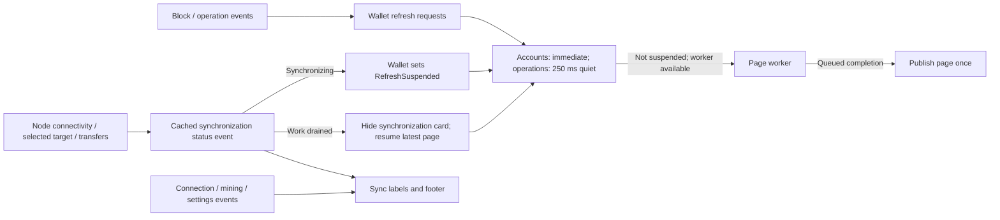

# Experimental Delphi and Lazarus wallet

The experimental wallet uses the existing PascalCoin node, safebox, wallet-key
storage and protocol operations with a shared VCL/LCL interface. Its operation wizards
share a model and support sending PASC, changing keys, listing/delisting an account
for sale, changing account information and buying a listed account. Version 5.9
also uses account-index paging, cached history queries and coalesced backend
refreshes during sync.

## Credits

Herman Schoenfeld developed the experimental GUI and its shared
[Sphere 10 Pascal Framework](https://github.com/HermanSchoenfeld/PascalFramework)
components. PascalCoin is based on Albert Molina's original implementation.
Copyright © 2016-2026 Albert Molina and Herman Schoenfeld.

## Grid paging and tool windows

Both wallet grids use the shared
[`TVisualGrid`](../libraries/sphere10/UVisualGrid.pas) square paging button.
Click its icon to choose a mode; the menu checks the active one and the tooltip
names it:

| Mode | Rows displayed |
|---|---|
| **Single** | All matching records on one scrollable page. |
| **Auto** | Only complete rows that fit the current viewport, with page navigation. |
| **Manual** | A chosen positive page size, remembered when switching modes. |

Changing mode starts at the first page. Single applies search and sorting to the
whole result; it loads all matching records rather than just a visible page.
The wallet starts in Auto. The same control and shared regression checks are
maintained in PascalFramework for Delphi/VCL and Lazarus/LCL.
The compact paging button and first-page button stay together in a right-anchored group;
narrow grids move totals and the manual page-size editor above the navigation.

The **Tools** menu opens Accounts, Operations, Blocks, Operations Explorer,
RAW / Multioperation Workbench, RPC Calls, Logs, Nodes and Messages; Synchronization
opens the embedded status view. Logs respect Options and RPC Calls remains
unavailable in explicit offline mode. Delphi loads each form's `.dfm` companion;
Lazarus loads its `.lfm`. Operation wizards attach their selected-account and
confirmation grids to their screen before loading data.

**Block Explorer → Tools** provides **Refresh** (F5) and **Reset block filters**.
Refresh keeps the selected range; reset clears both bounds and reloads the latest
local blocks. Both preserve hash-rate averaging and unit settings.

**Operations Explorer** opens details only for a left click on a data row.
Scrolling, keyboard navigation and programmatic selection do not open a dialog.

## Recent operation history

The wallet's **Recent Operations** dropdown applies to both selected accounts
and all wallet accounts. **7 Days** searches up to 2,016 blocks back; **30 Days**
searches up to 8,640. These ranges use the protocol's five-minute target, measured
from the current local tip. **Maximum** searches all locally stored operation
history, including older blocks in the legacy archive that are not yet indexed.
Changing the selected account retains the chosen range.

Stored history follows each account's previous-update links and stops at the
range boundary, without loading older blocks. Current pending operations remain
visible in every range. Selecting an account untouched by the live pending pool
skips that pool's operation scan. Queries run on the grid's background worker,
which displays the loading card until the requested result is ready.

A new account or history range cooperatively cancels the previous traversal;
its canceled result cannot replace the current selection. The accounts grid
refreshes immediately. The operations grid uses its owned 250 ms burst throttle
to fetch the latest retained request after that quiet interval. Each new request
restarts the wait. An active worker retires cooperatively before the latest
query runs, and the loading card clears when that page is published.

The [history adapter](core.utils/UDataSources.pas) currently collects the matching
pending and stored records before display paging, retaining exact totals and a
cached query snapshot. A cold whole-wallet query can therefore cost much more
than one selected account. Further pages of that unchanged snapshot reuse it.

## Account selection and operation screens

The recipient [Accounts selector](UFRMAccountSelect.pas) uses `TVisualGrid` for
background loading and paging. **My Accounts** and its key dropdown capture the
selected public-key identity; a key with no accounts shows an empty result.
Search, balance and sale filters retain their existing confirmed-account scope.
Unfiltered all-account pages use account numbers and safebox totals directly;
filtered queries retain matching IDs and convert only the requested page.

**Type Stats** runs its global confirmed-account scan on an owned background
task. The grid displays a loading card during calculation, then opens the existing
text report. Closing the selector cancels its work and retires queued callbacks.

Send PASC layouts use the native group-box content area for labels and controls,
including custom fee and the payload encryption, password and content steps.
Large edits and fee totals size themselves from the actual font metrics.
Change Account Info uses the same native caption spacing and measured edit
heights for its Name, Type and Options groups.

For a batch type change, accounts already at the requested type are skipped.
An injected review step reports the skipped and remaining counts and requires
approval before continuing. If all selected accounts match, return to Details
or cancel; no operations are submitted. Enable **Allow me to choose the fee**
to edit the fee; that screen also offers **Select a single fee payer** with an
eligible-account dropdown. Leave it unchecked for each updated account to pay
its own fee. Skipped changes incur no operation fee. Confirmation lists only
the accounts being updated. If refreshed account types change that reviewed
set before Finish, the wizard requires another review.

Final confirmation and result dialogs keep the summary and buttons visible while
the complete operation list scrolls in a read-only text area. Long lines can be
scrolled horizontally or selected for copying. No is the default confirmation
choice; Escape or closing the window declines submission.

Advanced Operation retains all six operation tabs. Its fee, signer and payload
controls use native font and group-box content measurements on Delphi and Lazarus,
including readable encryption choices and space below the Payload caption.

## Event-driven updates

The [application controller](UUserInterface.pas), [main form](UFRMMainForm.pas)
and [synchronization view](UCTRLSyncronization.pas) update from block, operation,
connection, mining and settings events. There is no periodic UI data/status
refresh timer. The node publishes a typed
[`TNodeSynchronizationStatus`](../core/UNode.pas) through its existing main-thread
notification bridge. Basic statistics come from a coherent cached record;
opening the detail screen does not wait for a new block or acquire core data locks.
Secondary block averages use an owned worker without holding a mempool read lock
while waiting for Bank/SafeBox reads.
Elapsed block-age text is refreshed by those events and view entry rather than
an idle clock tick.

The node uses the self-contained [core reader/writer lock](../core/UThread.pas)
for mempool access, adapted to PascalCoin's own thread IDs, critical sections and
clock helpers. PascalFramework's generic
[`TReadWriteLock`](../libraries/sphere10/UConcurrency.pas) remains mirrored for
general application use; core does not import `UConcurrency`.
Its `EnterReadScope`, `EnterWriteScope` and `EnterUpgradeableReadScope` factories
return the managed [`TScope`](../libraries/sphere10/UCommon.pas) record. Retain
one in a local variable for automatic release on routine return, `Exit` or an
exception. Copies share one acquisition; the lock must outlive them, and their
last release must run on the acquiring thread. `TScope.Create(CleanupMethod)`
also supports custom cleanup; its method target must outlive the scope.
[`TDisposables`](../libraries/sphere10/UMemory.pas) retains its independent
implementation for object and memory bags. Keep initialized bags in stable
locals or class fields; do not copy or return them. These generic library
additions do not change the core lock's dependency boundary.
`AcquireReadLock`, `AcquireUpgradeableReadLock` and `AcquireWriteLock` retain
ownership until the matching `Release*Lock` call on the same thread.
`TryAcquire*Lock` accepts a timeout in milliseconds.
Read-only queries can overlap; block application, pending
operation changes and miner recovery take exclusive write ownership. Timed read
admission keeps owned query workers cancellable. Writers still wait for active
readers, so this does not make a large snapshot free of synchronization costs.
The miner holds an upgradeable read while checking its cached template. A
rebuild acquires nested write ownership after releasing the template lock, then
rechecks the condition. `ReleaseWriteLock` retains the outer upgradeable read until its
matching `ReleaseUpgradeableReadLock`; unchanged templates do not take write ownership.

Wizard captions, validation messages, callbacks and grid bindings use native
`String` consistently in the wallet and PascalFramework. Operation helpers receive
the wizard's output message directly, without `AnsiString` conversion variables.
Protocol bytes and explicit encoding boundaries retain their existing types.

Core progress callbacks carry [`TProgressInfo`](../core/UAccounts.pas), containing
a typed stage, raw position/total counters and relevant block, chunk, peer or
file data. They do not construct display messages or percentages. The
[presentation adapter](../libraries/pascalcoin/UProgressDisplay.pas) formats that
data for the experimental/classic wallet, daemon logging and RPC status text.
The owned startup task queues a coherent record to the UI thread; cancellation
still propagates synchronously through core callbacks. A phase reaching its
total does not replace the task's separate completion event.

Consumers migrating from the old callback replace its message/count parameters
with one record:

```pascal
procedure TMyProgressView.OnProgress(Sender: TObject; const AProgress: TProgressInfo);
begin
  ProgressLabel.Caption := FormatProgressInfo(AProgress);
end;
```

The [accounts grid](UCTRLWallet.pas) admits refreshes immediately; its operations
grid uses the existing 250 ms trailing throttle to combine rapid selections.
The shared [visual grid](../libraries/sphere10/UVisualGrid.pas) retains the latest
request while busy and queues worker completion directly to the UI.
Overview totals start from page completion and publish through their
[data source's completion event](core.utils/UDataSources.pas). Animation,
delayed layout and existing Explorer task-completion timers are separate.
During node synchronization, both grids suspend provider queries, cooperatively
cancel active reads and retain the latest requested page. Their manual
**Please Wait / Synchronizing** cards follow node state. Selected remote targets keep this state across gaps between
download batches. Stopping networking prevents new downloads; already received
blocks continue processing and keep the synchronization hold active. Once that
work drains, offline/disconnected nodes load current local pages even if still
behind. A canceled older fetch cannot publish stale rows or errors after resuming.
Reconnecting alone cannot revive a stale remote target. Physical work is counted
until it actually finishes, independently of transport session generations.
The Accounts Explorer also consumes an opt-in idle notification from the shared
account-grid adapter when a cancelled filter finishes retiring, so admitted work
cannot depend on a later polling tick. Classic forms do not subscribe to it.



The node's synchronization states have explicit meanings:

| State | Meaning for the experimental wallet |
|---|---|
| `nssOffline` | Networking is disabled and no physical backlog remains; load local pages. |
| `nssDisconnected` | No peers or physical backlog remain; load local pages even while behind. |
| `nssIdle` | Connected, with no physical backlog (including retired-session work) and no selected target ahead. |
| `nssSynchronizing` | Download/validation/application work remains, including received blocks after network-off, or a selected connected peer's target is ahead; suspend grid reads. |
| `nssStorageError` | Persistence failed; pause synchronization and grid reads, retaining the first storage error until restart. |

[`TNodeNotifyEvents.OnSynchronizationChanged`](../core/UNode.pas) delivers a typed
status record on the main thread. Network producers only update facts and publish
notification flags; they do not call UI handlers synchronously. Within a notifier,
synchronization entry precedes block/operation callbacks and exit follows all
refresh-producing callbacks. This lets the wallet retain final refresh inputs
before resuming. `GetSynchronizationStatus` returns a short cached copy for view
entry, without acquiring mempool, Bank or SafeBox locks.

## Build

Open `../pascalcoin_wallet_experimental.lpi` in Lazarus, or build from the repository
root with FPC/Lazarus installed. The local Windows build was verified with FPC 3.2.0
and Lazarus 2.1.0:

```powershell
& <lazarus>\lazbuild.exe --pcp="$env:TEMP\PascalCoinBuildConfig" `
  --compiler=<fpc>\bin\x86_64-win64\fpc.exe --lazarusdir=<lazarus> `
  --skip-dependencies --no-write-project --build-mode=Release -B `
  src\pascalcoin_wallet_experimental.lpi
```

In Lazarus, select `Debug` or `Release` from **Project > Project Options > Build
modes**, or use `--build-mode=Debug` / `--build-mode=Release` with `lazbuild`.
Debug disables optimization and includes debug symbols; Release enables level-2
optimization and strips debug symbols. The previous `Default` mode remains available.
Each mode has a separate experimental unit-output directory. The normal output is
`src/PascalCoinWalletExperimental.exe`. OpenSSL 1.1
must be available at runtime (`libcrypto-1_1-x64.dll` for Windows x64).
For a fresh checkout, copy the matching DLL from `windows-dll` into `src`
once before launching the wallet. The test runners resolve the deployed copy
first and otherwise use `windows-dll`, copying it only into their own output.

These commands invoke Free Pascal. For Delphi, open
[pascalcoin_wallet_experimental.dproj](../pascalcoin_wallet_experimental.dproj)
in the IDE, then expand **Build Configurations** in Project Manager and activate
`Debug` or `Release`. Open the `.dproj` to load its saved configurations.
The actual project builds and passes separate offline startup/close
checks with Delphi 13 Community Edition, Win64 Debug. Win32 is configured but
has not received the same full-wallet build and runtime verification. Community
Edition's command-line compilers are edition-restricted; use its IDE compiler.

The Delphi project defaults to Win64 Debug and creates
`src/pascalcoin_wallet_experimental.exe`, beside the existing OpenSSL runtimes
and `locale` directory, following the classic wallet layout. Win64 uses
`libcrypto-1_1-x64.dll`; Win32 uses `libcrypto-1_1.dll`. DCUs and compiler-generated
resources stay in `src/lib/Delphi/<platform>/experimental/<configuration>`.
The project has no pre/post-build commands and requires no build-event trust
approval. When distributing the executable, retain its matching runtime and
`locale/<language>/LC_MESSAGES/default.mo` catalogs beside it.

The shared sources select VCL or LCL APIs and paired `.dfm`/`.lfm` resources.
Separate VCL checks cover all 48 form resources, the real Dutch catalog, grid
parenting and empty selections, unsigned PASC balance formatting, wizard
navigation, and banner transparency.

## Start with an isolated wallet

```powershell
& .\src\PascalCoinWalletExperimental.exe --data-dir="<local-folder>" `
  --offline --no-startup-dialogs
```

For the Delphi build, use the same options with its executable:

```powershell
& .\src\pascalcoin_wallet_experimental.exe --data-dir="<local-folder>" `
  --offline --no-startup-dialogs
```

Choose a new folder. `--data-dir` selects the settings, wallet keys and blockchain
directory before they are opened. `--offline` disables peer discovery, connections,
peer listening, RPC and mining for the lifetime of the process, including later
settings changes. Saved network preferences are retained for the next normal run.
`--no-startup-dialogs` suppresses startup error dialogs. `--help` prints the options
without starting the wallet.

An empty blockchain finishes local loading and displays disconnected status; it
does not wait indefinitely for its first block. Start without `--offline` to use
normal networking and synchronize. Account activity requires a synchronized node
and suitable accounts/keys.

Local loading keeps the main window responsive and offers Cancel startup. Native
Close cancels loading and joins the worker. Commands that require loaded accounts
remain disabled until loading finishes. The About dialog opens from its menu.
During initialization, the window keeps its initial height and permits horizontal
resizing. Maximizing is disabled until initialization finishes; success or an
error restores the original height constraints and maximize command.

An existing node may also have many saved pending operations. Startup reports
their decoding, preparation, signature validation and application separately.
The status appears in bold white 16-point text below the PascalCoin logo. A
finalizing phase completes pending-state initialization on the loading worker
before the wallet opens; application, taskbar and tray use the PascalCoin icon.
Cancel startup and native Close interrupt these phases; cancellation preserves the
saved pending buffer rather than writing an incomplete restore over it.

Finalization clears marker collections in bulk and buffers pending serialization
before copying it to disk. An isolated check with 185,831 saved operations keeps
the exact original bytes; cleanup takes 203 ms and saving 125 ms on the measured
machine. The native dense-data check bounds the final post-application transition
to 688 ms and closes active grid/aggregate work in 8.734 seconds. Cold history
queries still run in the background; these timings do not promise an instant
full-history query on every machine.

The Accounts Explorer reuses the wallet's existing key index and caches the
account records needed for visible rows. Selected public keys are copied to the
worker for index lookup, keeping key selection responsive during an existing
ownership scan. Filtering, selected-account totals and operation history run on
owned workers; newer selections replace pending work,
and shutdown cancels and joins it. Painting uses cached records instead of
reading the safebox on the UI thread.

The header artwork and language selector follow the window width, and the
lock/network/synchronization buttons stay inside the footer while loading,
maximized and restored. Their layout uses the status panel's themed interior,
leaving its border and resize grip clear, including after DPI changes.
From left to right they control the wallet lock, network
connectivity and synchronization view. Switching the view keeps network policy
unchanged. Wallet Keys draws its original padlock artwork directly from the
image list, including the disabled no-password state.
Background loading and error cards preserve an open
modeless window's activation and keyboard focus.
## Wallet behavior

- Wallet Keys generates/imports keys and supports password protection,
  export/backup and restore. Watch-only keys cannot sign operations. Private-key
  creation/import requires an unlocked target wallet.
- The account filter preserves an existing selection and falls back to Show All
  after its key is removed. Pending operations and balances refresh through the
  existing node notifications and background page workers.
- The default account grid counts entries in the selected keys' indexes, merges
  account-ID prefixes and reads full account records only for the visible page.
  Arbitrary searches and other sort orders use a cached full query of the selected
  key's accounts, or all owned accounts for Show All. Pending ownership changes
  are included even when the total account count stays the same.
- Overview totals always cover the whole wallet, independently of the grid's key
  filter. A separate cancellable worker calculates them in short lock-held chunks
  while retaining the previous complete total until a coherent result is ready.
  Balance-cell painting uses fetched values and never waits for core locks.
- Pending history scans the operation tree once for the selection, retaining each
  account's rows and balance context. The history grid and full-query account
  fallback reuse raw and filtered/sorted snapshots for subsequent pages.
  Account/history-depth settings remain responsive during background fetching.
- The accounts grid refreshes immediately. The operations grid coalesces requests
  through `RefreshThrottle` after 250 ms without another request. Every new
  selection, filter, page or size request restarts that wait. Busy or hidden grids
  retain the latest input; an older canceled worker retires before its replacement
  starts. Loading has no additional minimum display time.
- Internal result/layout replay is not a new client input. Complete first-page
  results can be reused after capacity changes. Wallet history membership is
  resolved on its worker. Overview aggregate work pauses during node
  synchronization and starts from page completion when local data is ready.
- Each grid retains its rows and shows a bordered **Please Wait / Synchronizing**
  card with Sphere10's rounded-spoke animation while the node reports
  `nssSynchronizing`. Grid, search and paging input are disabled during that hold.
  At synchronization end,
  the card clears and the latest retained request resumes once. Network-off or
  last-peer disconnect releases it only after already received work drains;
  the normal automatic fetch card then applies.
  Quick cached fetches avoid flashing that delayed automatic card.
- The chain footer and synchronization view use the same cached, committed node
  record for their block count and timestamp. The synchronization view also shows
  its target and pending total. Publishing these facts never reads the safebox on
  the UI thread. Local-load completion primes the snapshot and
  opening the view reads it immediately; secondary statistics retain their last
  complete result while core work is busy. Data/status updates use events.
- Mining selection reuses eligible existing private-key entries, including locked
  encrypted entries. Startup and ordinary selection never create a replacement
  private key or rewrite the selection; mining stays inactive if no eligible key
  exists. The configured NewEachTime policy rotates only after a mined block while
  the wallet is unlocked and writable.
- Get An Account explains how to receive a PASA and opens Wallet Keys to create or
  copy a public key. Generating a key does not allocate a blockchain account.
- Operation wizards retain typed values across navigation, validate before
  signing, and keep one stationary host window. Declined confirmation leaves the
  wizard open. A wizard releases only the unlock it acquired.
- Signed operations are prepared from fresh pending account snapshots. Batch
  signing tracks cumulative fees and operation counters. Buying an account supports
  the target's existing balance toward its price.
- The operations menu can inspect a selected operation or copy its operation hash.

## Classic wallet features

The [feature map](FEATURES.md) shows where the classic wallet's production features
are available in this interface. The six focused operation wizards remain, with
the existing classic advanced form and RAW workbench available alongside them.

- **Wallet → Advanced Operation** supports the classic advanced account/sale/swap,
  account-data, EPASA and payload options for the selected accounts.
- **Tools → RAW / Multioperation Workbench** imports, edits, combines, signs and
  exports operation packages. Import returned partial copies of the same unchanged
  multioperation to retain each party's missing signatures. Repeated imports are
  idempotent; conflicting bodies/counters leave the package unchanged. The core
  verifies all required signatures before executing the selected operation.
  Offline mode permits local work and blocks RPC and submission.
- **Tools → RPC Calls** opens the existing RPC client at the configured local port.
- The account explorer supports account numbers and name prefixes, balance
  filters, a persistent selected-account list, and current count/balance totals.
  Its renderer reads a bounded `TActionCache`; an owned worker loads requested
  account records and summary values without blocking painting on node locks.
  Account history runs on a separate cancellable worker. Selection and filter
  changes coalesce, completed generations replace previous rows, and closing the
  form joins its workers before releasing their controls and callbacks.
  Key filters pass a copied public key to the worker; selecting another key never
  waits for the broad query's key-index lock. Completed row replacements also
  update the history selection when the new accounts are already cached.
- The block explorer saves the averaging window and units from h/s through Eh/s.
- Messages are retained while their window is closed; recipient choices follow
  current connections and opening the window clears its unread count.
- Options apply checkpoint-download and log-display preferences and offer the
  installed language catalogs. English and Dutch currently contain usable content;
  untranslated labels retain their source text. Language changes apply on restart.
- Key import/export accepts the classic serialized and protected formats, bare
  legacy secrets, and exported or raw public keys. The key wizard preserves entered
  values when navigating Back. Leaving the export password empty produces an
  unencrypted serialized private key, matching the classic format.

The implementation reuses `TDisposables`, component ownership, existing multicast
events, collection helpers, UI docking, throttling, logging and core operation
constructors. The embedded [wizard](../libraries/sphere10/UWizard.pas) and
[cache](../libraries/sphere10/UCache.pas) retain the existing Object Pascal style
and compile with both Free Pascal/Lazarus and Delphi/VCL.

## Synchronization and pending operations

Received blocks are validated and applied on the existing background transport
workers. Network-off stops new requests; already received blocks continue to
completion and keep the node synchronizing. Grid queries remain suspended for
that work and resume once with the latest page/filter intent after it drains.
Notifications publish cached facts and flags; they do not call grid listeners
from the block-processing thread. Each bank commit and pending reconciliation
share one node write scope, so readers cannot observe a new confirmed base with
old pending account changes.

The experimental wallet serializes connectivity, listener-port, mining-payload
and reward-key changes on one owned settings task. Wallet key selection and the
configured post-block rotation policy retain their UI-thread owner; the worker
receives copied public configuration. A superseded request stops at a complete
boundary and the latest request follows it. Node notifications ask the existing
mining worker to clear/capture jobs instead of taking pool or node locks on the
UI thread. The existing protocol timestamp refresh cadence remains unchanged.

Large pending pools also have an independent core processing cost. A restored
public-data fixture with 841,529 blocks and 185,831 pending operations reproduced
about 10.1 seconds of CPU work per sanitization without any UI or networking.
The implementation retains valid lookup indexes, bulk-builds rejected-operation
results and reuses the existing account cache. The experimental wallet configures
a bounded 250,000-account cache; core/default callers retain their 50,000 limit.
The configured limit survives safebox replacement and stale records are cleared.

The same FPC fixture measured a 6,766 ms cold pass and 3,531 / 3,578 ms warm passes,
compared with 10,188 / 10,110 / 10,140 ms before these changes. Ordered operations,
both indexes, fees, hashes and all 21,183,301 pending-file bytes were unchanged.
The restored process used about 26 MiB more private memory in that comparison.
These are core replay measurements, not measured live-peer download rates.

A subsequent controlled core benchmark applied real mainnet blocks 841,529–841,533
through full proof-of-work and bank validation in 4,000 / 3,578 / 3,515 / 3,453 /
3,469 ms. All 185,831 pending operations remained valid, their serialized bytes
and independent index/hash/fee checks stayed identical, and the five stored blocks
reopened successfully. These timings describe that copied fixture and host.

Pending storage writes a complete temporary package in the destination directory
before atomically replacing the previous file. The saver captures a final dirty
batch during shutdown. Failed publication preserves the previous complete file
and reports the I/O error; workers are joined without forced thread termination.

Safebox checkpoints also publish through a validated temporary file and atomic
replacement. A failed save preserves the previous checkpoint. Startup skips
invalid candidates and restores the newest eligible valid copy; if none is valid,
it reports the error without replacing the chain with an empty one. A storage
failure pauses synchronization until restart and displays its stage, file and
cause. Later progress or network toggles cannot clear that error.

## Regression tests

The suites cover wallet operations, shared framework utilities, source queries,
received-block draining, committed footer facts and stored-block recovery. The
storage regression group contains 27 cases, and the node lifecycle group contains
17; both run in FPCUnit and dedicated Delphi/FPC probes. Native backlog checks
include a two-batch download with a quiet gap, keeping both synchronization cards
visible until the selected target is reached. See the
[test guide](../tests/experimental/README.md) for entry points and fixture limits.

From the repository root:

```powershell
& src\tests\experimental\RunExperimentalWalletTests.ps1
& src\tests\experimental\native\RunWalletStartupNativeTests.ps1
& src\tests\experimental\RunWalletGridRefreshTests.ps1
```

These scripts accept `-FpcPath` and `-LazarusDirectory`. The
[interactive grid refresh demo](../tests/experimental/native/grid-refresh/README.md)
has Lazarus and Delphi projects, controlled sync bursts and actual fetch counters.
Its dedicated fixture verifies paging, selection and held loading cards using the
main wallet's real wiring. See the
[test guide](../tests/experimental/README.md) and the
[native startup checks](../tests/experimental/native/README.md) for coverage and
output locations. The tests generate temporary keys/data and run native windows
on a separate Windows desktop without switching the input desktop. They do not
use the normal wallet or broadcast transactions.

Offline core acceptance establishes the tested operation semantics; these checks
do not establish long-running mainnet synchronization or live transaction delivery.
