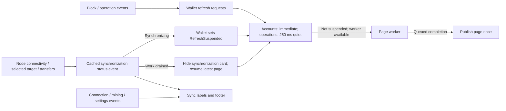

# Experimental Delphi and Lazarus wallet

The experimental wallet is a shared VCL and LCL interface to the PascalCoin
node, safebox, wallet keys and protocol operations. Its wizards send PASC,
change keys, list or delist an account for sale, change account information and
buy a listed account. The [root README](../../README.md) lists its features, and
the [feature map](FEATURES.md) shows where the classic wallet's production
features appear in this interface.

## Build

### Lazarus/FPC

Open `../pascalcoin_wallet_experimental.lpi` in Lazarus, or build from the
repository root with Lazarus/FPC installed. The example uses FPC 3.2.0 and
Lazarus 2.1.0, the versions verified on a local Windows build:

```powershell
& <lazarus>\lazbuild.exe --pcp="$env:TEMP\PascalCoinBuildConfig" `
  --compiler=<fpc>\bin\x86_64-win64\fpc.exe --lazarusdir=<lazarus> `
  --skip-dependencies --no-write-project --build-mode=Release -B `
  src\pascalcoin_wallet_experimental.lpi
```

Choose a build mode in **Project > Project Options > Build modes**, or pass
`--build-mode=Debug` or `--build-mode=Release` to `lazbuild`:

- `Debug` disables optimization and includes debug symbols.
- `Release` enables level-2 optimization and strips debug symbols.
- `Default` disables optimization.

Units go to `src/lib/<cpu>-<os>/experimental/<mode>` and the executable to
`src/PascalCoinWalletExperimental.exe`.

OpenSSL 1.1 must be available at runtime (`libcrypto-1_1-x64.dll` for Windows
x64). In a new checkout, copy the matching DLL from `windows-dll` into `src`
once before you launch the wallet.

### Delphi

Open
[pascalcoin_wallet_experimental.dproj](../pascalcoin_wallet_experimental.dproj)
in the Delphi IDE. In Project Manager, expand **Build Configurations** and
activate `Debug` or `Release`.

The Win64 Debug configuration builds and runs with Delphi 13 Community Edition.
Win32 is configured but not verified. Community Edition restricts its
command-line compilers, so use its IDE compiler.

The Delphi project defaults to Win64 Debug. It creates
`src/pascalcoin_wallet_experimental.exe` beside the OpenSSL runtimes and the
`locale` directory. Win64 uses `libcrypto-1_1-x64.dll` and Win32 uses
`libcrypto-1_1.dll`. DCUs and compiler-generated resources stay in
`src/lib/Delphi/<platform>/experimental/<configuration>`.

To distribute the executable, keep its matching runtime and the
`locale/<language>/LC_MESSAGES/default.mo` catalogs beside it.

## Start the wallet

Start the wallet offline with a new data folder:

```powershell
& .\src\PascalCoinWalletExperimental.exe --data-dir="<local-folder>" `
  --offline --no-startup-dialogs
```

For the Delphi build, use the same options with its executable:

```powershell
& .\src\pascalcoin_wallet_experimental.exe --data-dir="<local-folder>" `
  --offline --no-startup-dialogs
```

| Switch | Effect |
|---|---|
| `--data-dir` | Selects the folder for settings, wallet keys and the blockchain. |
| `--offline` | Disables peer discovery, connections, peer listening, RPC and mining until the process exits, even if settings change. |
| `--no-startup-dialogs` | Suppresses startup error dialogs. |
| `--help` | Prints the options without starting the wallet. |

In offline mode, **Tools → RPC Calls** is unavailable, and the RAW workbench
works locally but cannot submit. Saved network preferences stay for the next
normal run. Start without `--offline` to synchronize. An empty blockchain
finishes loading and shows disconnected status.

To stop loading local data, click **Cancel startup** or close the window.
Canceling leaves the saved pending operations unchanged.

## Use the wallet

The **Tools** menu opens Accounts, Operations, Blocks, Operations Explorer,
RAW / Multioperation Workbench, RPC Calls, Logs, Nodes, Messages and
Synchronization. The footer buttons control, from left to right, the wallet
lock, network connectivity and the synchronization view. In
**Operations Explorer**, left-click a data row to open its details.

### Grid paging

Both wallet grids and the recipient [Accounts selector](UFRMAccountSelect.pas)
use the shared [`TVisualGrid`](../libraries/sphere10/UVisualGrid.pas) for
background loading and paging. In the wallet grids, click the square paging
button to choose a mode:

| Mode | Rows displayed |
|---|---|
| **Single** | All matching records on one scrollable page. |
| **Auto** | Only complete rows that fit the current viewport, with page navigation. |
| **Manual** | A chosen positive page size, remembered when switching modes. |

The wallet starts in Auto. PascalFramework maintains this control and its
checks.

### Recent operations

The **Recent Operations** dropdown sets the history range for the selected
accounts or the whole wallet:

| Range | Searches |
|---|---|
| **7 Days** | Up to 2,016 blocks back from the local tip. |
| **30 Days** | Up to 8,640 blocks back from the local tip. |
| **Maximum** | All locally stored history. |

Pending operations appear in every range.

### Batch account type changes

A batch type change skips accounts already at the requested type. A review step
shows the skipped and remaining counts and needs your approval. Skipped changes
incur no fee, and the confirmation lists only the updated accounts.

To edit the fee, enable **Allow me to choose the fee**. The fee step it adds
also offers **Select a single fee payer**, which charges every fee to one
eligible account. Leave it unchecked so that each updated account pays its own
fee.

### Caveats

- **Single** mode loads every matching record.
- Searches and non-default sort orders run a full query of the selected key's
  accounts, or of all wallet accounts under **Show All**.
- A cold whole-wallet history query can cost much more than one account's,
  because the [history adapter](core.utils/UDataSources.pas) collects every
  matching record before paging.
- While the node synchronizes, both grids show a
  **Please Wait / Synchronizing** card and disable input. If you turn
  networking off or the last peer disconnects, the card stays until received
  blocks are processed.
- Final confirmation defaults to **No**. Escape or closing the window declines
  submission.
- An empty export password exports the private key unencrypted.
- A storage failure pauses synchronization and shows its stage, file and cause
  until you restart. Toggling the network does not clear it.

## Developer notes

### Events and synchronization

The [application controller](UUserInterface.pas), [main form](UFRMMainForm.pas)
and [synchronization view](UCTRLSyncronization.pas) update from block,
operation, connection, mining and settings events. No periodic timer refreshes
UI data or status. Network producers only update state and set notification
flags. They never call UI handlers synchronously.

The node publishes a typed [`TNodeSynchronizationStatus`](../core/UNode.pas)
record, and [`TNodeNotifyEvents.OnSynchronizationChanged`](../core/UNode.pas)
delivers it on the main thread. Within a notifier, synchronization entry
precedes block and operation callbacks, and exit follows all refresh-producing
callbacks. `GetSynchronizationStatus` returns a cached copy without acquiring
mempool, Bank or SafeBox locks.

| State | Meaning for the experimental wallet |
|---|---|
| `nssOffline` | Networking is off and no physical backlog remains, so grids load local pages. |
| `nssDisconnected` | No peers or physical backlog remain, so grids load local pages even while behind. |
| `nssIdle` | Connected, with no physical backlog and no selected target ahead. |
| `nssSynchronizing` | Blocks remain to download, validate or apply, or a selected connected peer's target is ahead, so grid reads are suspended. |
| `nssStorageError` | Persistence failed, so synchronization and grid reads pause and the first storage error stays until restart. |

The [wallet control](UCTRLWallet.pas) refreshes its accounts grid at once. The
operations grid's `RefreshThrottle` waits for 250 ms without a new request,
then fetches the latest one. Refresh requests and synchronization status flow
as follows:



### Threads and locking

Connectivity, listener-port, mining-payload and reward-key changes run one at a
time on a single settings task, which receives a copy of the public
configuration. Wallet key selection and the configured post-block rotation
policy stay on the UI thread.

The node guards mempool access with the
[core read-write lock](../core/UThread.pas), and core does not import
`UConcurrency`. PascalFramework's
[`TReadWriteLock`](../libraries/sphere10/UConcurrency.pas) is mirrored for
application code.

- `AcquireReadLock`, `AcquireUpgradeableReadLock` and `AcquireWriteLock` retain
  ownership until the matching `Release*Lock` call on the same thread.
  `TryAcquire*Lock` accepts a timeout in milliseconds.
- A plain read cannot be promoted, so take an upgradeable read before a
  possible write. After the nested write, `ReleaseWriteLock` keeps the outer
  upgradeable read until its matching `ReleaseUpgradeableReadLock`.
- The framework `TReadWriteLock` factories `EnterReadScope`, `EnterWriteScope`
  and `EnterUpgradeableReadScope` return the managed
  [`TScope`](../libraries/sphere10/UCommon.pas) record. Keep it in a local
  variable so that it releases on routine return, `Exit` or an exception.
  Copies share one acquisition. The lock must outlive them, and their last
  release must run on the acquiring thread.
- `TScope.Create(CleanupMethod)` also supports custom cleanup. Its method target
  must outlive the scope.
- Keep initialized [`TDisposables`](../libraries/sphere10/UMemory.pas) object
  and memory bags in stable locals or class fields, and do not copy or return
  them.

Read-only queries can overlap. Block application, pending operation changes and
miner recovery take exclusive write ownership. Each bank commit and its pending
reconciliation share one write scope, so readers never see a new confirmed base
with old pending changes.

### Progress reporting

Core progress callbacks carry a [`TProgressInfo`](../core/UAccounts.pas) record
with a typed stage, raw position and total counters, and the relevant block,
chunk, peer or file data. They do not construct display messages or
percentages. The
[presentation adapter](../libraries/pascalcoin/UProgressDisplay.pas) formats
the record for both wallets, daemon logging and RPC status text. The startup
task queues only the latest complete record to the UI thread and drops
superseded ones. Cancellation propagates synchronously through core callbacks.
A phase that reaches its total is not completion, which the task signals with a
separate event.

To migrate from the old callback, replace its message and count parameters with
one record:

```pascal
procedure TMyProgressView.OnProgress(Sender: TObject; const AProgress: TProgressInfo);
begin
  ProgressLabel.Caption := FormatProgressInfo(AProgress);
end;
```

### Conventions

The shared sources select VCL or LCL APIs, and each form has paired `.dfm` and
`.lfm` resources. The embedded [wizard](../libraries/sphere10/UWizard.pas) and
[cache](../libraries/sphere10/UCache.pas) compile with both Lazarus/FPC and
Delphi. Wizard captions, validation messages, callbacks and grid bindings use
native `String` in the wallet and PascalFramework. Protocol bytes and explicit
encoding boundaries keep their own types.

### Large pending pools

The experimental wallet sets a 250,000-account cache, while core and other
callers keep the 50,000 default. The configured limit survives safebox
replacement.

On a copied public chain with 185,831 pending operations, offline FPC
sanitization took 6,766 ms cold and 3,531 ms warm, and closing the wallet
during active grid work took 8,734 ms. The
[block application probes](../tests/experimental/native/block-throughput/README.md#results)
report block application timings.

## Regression tests

From the repository root:

```powershell
& src\tests\experimental\RunExperimentalWalletTests.ps1
& src\tests\experimental\native\RunWalletStartupNativeTests.ps1
& src\tests\experimental\RunWalletGridRefreshTests.ps1
```

These scripts accept `-FpcPath` and `-LazarusDirectory`, which default to the
paths in the build example. The tests run on a separate Windows desktop with
temporary keys and data. They never use the normal wallet or broadcast
transactions, and they do not cover live synchronization or transaction
delivery.

The [test guide](../tests/experimental/README.md), the
[native startup checks](../tests/experimental/native/README.md) and the
[interactive grid refresh demo](../tests/experimental/native/grid-refresh/README.md)
describe coverage, fixture limits and output locations.

## Credits

Herman Schoenfeld developed the experimental GUI and its shared
[Sphere 10 Pascal Framework](https://github.com/HermanSchoenfeld/PascalFramework)
components. PascalCoin is based on Albert Molina's original implementation.
Copyright © 2016-2026 Albert Molina and Herman Schoenfeld.
