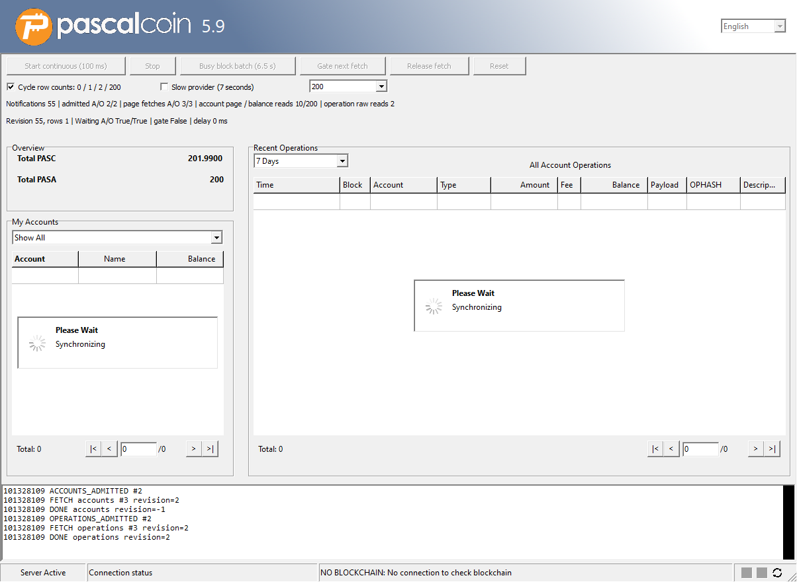

# Wallet grid refresh test

This mock wallet runs the production main form and grids over generated account
and history records. It checks that:

- accounts refresh at once (`RefreshThrottle.Mode = temNone`)
- operations fetch only the latest request after 250 ms of quiet
  (`temNotifyOnEventBurstFinished`)
- both grids show **Please Wait / Synchronizing** and run no queries during node
  synchronization

Focused cases check wallet tools and dialogs.



## Build and run

Open [WalletGridRefreshDemo.lpi](WalletGridRefreshDemo.lpi) in Lazarus or
[WalletGridRefreshDemo.dproj](WalletGridRefreshDemo.dproj) in Delphi. Lazarus
builds `WalletGridRefreshDemoFPC.exe` and Delphi builds `WalletGridRefreshDemo.exe`,
both into `src` beside the OpenSSL runtime.

From the repository root, run:

```powershell
& .\src\tests\experimental\RunWalletGridRefreshTests.ps1 -Demo
```

The script builds the demo with Windows x64 FPC and runs it through the
[private-desktop broker](../README.md#private-desktop-broker). Pass `-FpcPath` and `-LazarusDirectory`
to select FPC and Lazarus, and `-OutputDirectory <new-directory>` to choose
where results go. The default run covers the first four
[focused cases](#focused-cases).

## Interactive controls

Run an executable without arguments to use these controls. Transaction and
detail popups stay disabled.

- **Start sync (100 ms)** starts node synchronization with backend events, while
  both grids run no queries.
- **Stop** ends it and loads the latest local data.
- **Busy block batch (6.5 s)** shows the same pause during one long block batch.
- **Slow provider (7 seconds)**, **Gate next fetch** and **Release fetch** show
  the loading state.
- **Cycle row counts** switches between empty, one-row, two-row and larger
  results.
- **Reset** stops synchronization, releases held fetches and restores 200
  records.

## Focused cases

Set one of these environment variables before an automatic run. Each runs only
its case group:

- `PASCAL_WALLET_KEY_NOTIFICATIONS_ONLY=1` checks wallet-key notifications from
  a worker thread.
- `PASCAL_WALLET_CONSECUTIVE_SELECTION_ONLY=1` checks a transfer between two
  owned fixture accounts: repeated sender clicks keep the same debit, selecting
  the receiver shows its credit, and explicitly clearing selection shows both
  rows under **All Account Operations**. The real Show All dropdown handler must also
  clear the old selection and restore wallet-wide history. It then makes 20 alternating clicks and an
  eight-click burst including repeats. Each independent selection must publish
  within one second; the burst admits only the latest account after 250 ms of quiet.
- `PASCAL_WALLET_SELECTION_COMPLETION_ONLY=1` selects two accounts in a row, each
  with 268 generated operations.
- `PASCAL_WALLET_REFRESH_LIFECYCLE_ONLY=1` checks refresh timing, held fetches
  and the synchronization pause.
- `PASCAL_WALLET_SELECTION_ONLY=1` checks selection, loading, overview totals and
  native banner and event presentation.
- `PASCAL_WALLET_SAFEBOX_LOG_ONLY=1` checks structured safebox progress, Info
  logging and node status.
- `PASCAL_WALLET_SYNC_PAINT_ONLY=1` checks synchronization presentation.
- `PASCAL_WALLET_TOOLS_ONLY=1` runs
  [UWalletToolsDialogChecks](UWalletToolsDialogChecks.pas). It opens all ten
  Tools menu entries and the Change All Key wizard, and checks the Overview
  layout at normal and 150% scale. Inspect wizard grid cells in the
  `*-native-grid.bmp` captures. It and the combined cases below need the same
  files as [Send PASC](#send-pasc-presentation).
- `PASCAL_WALLET_CHANGE_INFO_UI_ONLY=1` checks single-account and batch Change
  Account Info at 100% and 150%. It needs the same files as
  [Send PASC](#send-pasc-presentation) and saves eight screen BMPs beside its
  log. Inspect each compiler's images and require
  `PASS native Change Account Info presentation` and exit code zero.
- `PASCAL_WALLET_CHANGE_INFO_APPROVAL_ONLY=1` runs six Change Account Info
  wizard cases at 100% and 150%, including skipped-account consent and
  single-payer fee selection. It saves each screen beside its log.
- `PASCAL_WALLET_OPERATION_MESSAGE_ONLY=1` runs 13 operation-message dialog
  cases at 100% and 150% and saves captures beside the test log.
- `PASCAL_WALLET_ADVANCED_UI_ONLY=1` captures all six Advanced Operation tabs at
  100% and 150%. It needs a 1920x1080 or larger desktop.
- `PASCAL_WALLET_SEND_UI_ONLY=1` runs
  [Send PASC presentation](#send-pasc-presentation).

Combine these with `PASCAL_WALLET_TOOLS_ONLY=1`:

- `PASCAL_WALLET_OPERATION_INPUT_ONLY=1` checks which input opens operation
  details, the wallet footers at 100%, 125% and 150%, and the
  [operation-information layout](UWalletOperationInfoLayoutChecks.pas). Build
  with `-O2`, as the script does.
- `PASCAL_WALLET_HISTORY_DEPTH_ONLY=1` checks that the Recent Operations picker
  passes `FetchAll` a depth of 2,016 for 7 Days, 8,640 for 30 Days and
  `High(Cardinal)` for Maximum.
- `PASCAL_WALLET_BLOCK_TOOLS_ONLY=1` checks Block Explorer **Refresh (F5)** and
  **Reset block filters**. Its `<main-log-stem>.tools.log` ends with
  `PASS actual Block Explorer Tools refresh/reset checks`.

These checks have their own entry points:

- [batch preparation checks](../../operations/UChangeInfoBatchChecks.pas), through
  [FPCUnit](../../operations/UChangeInfoBatchTests.pas) or, under Delphi,
  `RunChangeInfoBatchChecks(LogFile)`
- [stored-history checks](../stored-history/README.md)
- [FPCUnit fixture](../../ui/UWalletGridIntegrationTests.pas)
- [network-off probe](WalletNetworkOffProbe.dproj)
- [received-block backlog checks](../network-backlog/README.md)

## Send PASC presentation

Run [UWalletSendPresentationChecks](UWalletSendPresentationChecks.pas) through
the broker with only `PASCAL_WALLET_SEND_UI_ONLY=1` set. Build the target, create
a new output directory, and put
[mainnet-blocks-0-4.bin](../../fixtures/mainnet-blocks-0-4.bin) and the matching
OpenSSL runtime beside the executable. For example:

```powershell
$previous = $env:PASCAL_WALLET_SEND_UI_ONLY
$env:PASCAL_WALLET_SEND_UI_ONLY = '1'
try {
  & $Broker $WalletGridRefreshExe '<new-folder>\tests.log'
} finally {
  $env:PASCAL_WALLET_SEND_UI_ONLY = $previous
}
```

Six routes cover the default fee, a custom fee, and public, sender-key,
recipient-key and password-encrypted payloads, at 100% and 150% font scale.

BMPs named by route, step and scale go beside `<main-log-stem>.send-ui.log`. A
pass writes `PASS native Send PASC presentation` and exits with code zero. A
failure exits nonzero. Run both the Delphi (VCL) and Lazarus (LCL) targets and
inspect each one's BMPs and log.

## Safety

- Every run uses a new temporary data folder, never your wallet.
- Runs with `PASCAL_WALLET_TOOLS_ONLY=1` go online with settings restricted to
  the loopback endpoint `127.0.0.1:1` and never connect to public peers. Other
  runs stay offline.
- No case signs, submits or broadcasts an operation.
